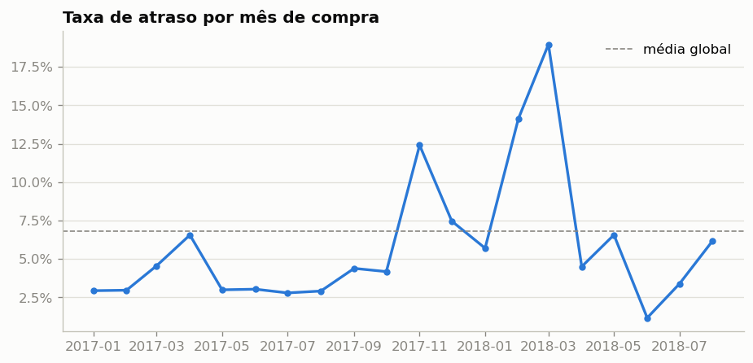
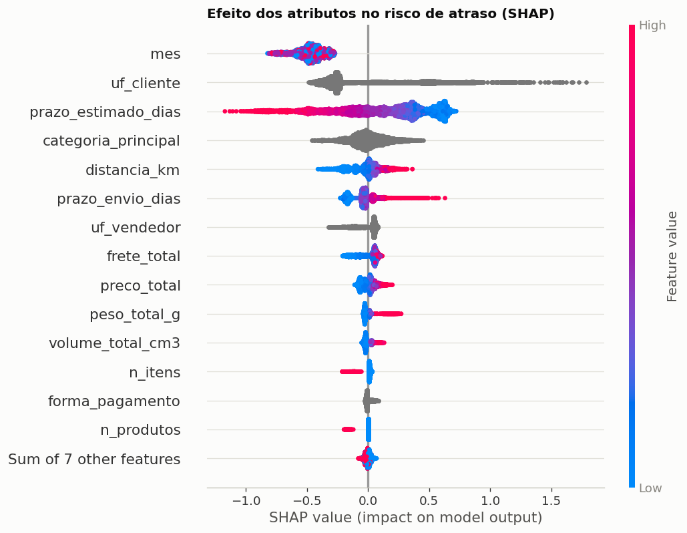
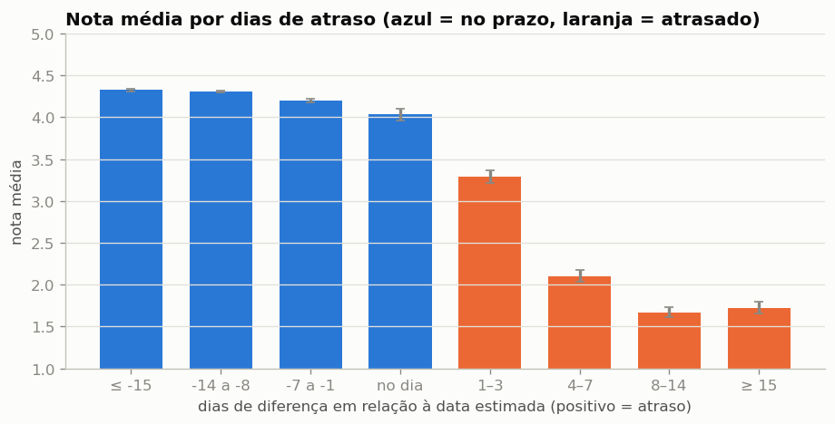

# Atraso de Entrega e Satisfação do Cliente — Olist

Projeto de Ciência de Dados que **prevê, no momento da compra, a probabilidade de um pedido atrasar** e **mede o efeito causal do atraso sobre a nota de avaliação**, com o dataset público de e-commerce da Olist. Os requisitos de cada análise estão no [PRD](DOCs/PRD.md); os IDs (RA-xx, H-xx, RNF-xx) são citados nos notebooks.

## Problema

Num marketplace, o prazo estimado no checkout é uma promessa. Hoje a operação só descobre o atraso depois que ele acontece, quando a avaliação negativa já foi registrada. O projeto responde duas perguntas: dá para **antecipar** quais pedidos vão atrasar? E **quanto** o atraso, isoladamente, derruba a nota?

## Dados

- [Brazilian E-Commerce Public Dataset by Olist](https://www.kaggle.com/datasets/olistbr/brazilian-ecommerce) (versão 2), nove tabelas relacionais.
- Base analítica: **96.203 pedidos entregues**, comprados entre jan/2017 e ago/2018, uma linha por pedido.
- Alvo: atraso = data de entrega real posterior à estimada, **comparando só a data**. Comparar timestamps marcaria 1.291 pedidos entregues no próprio dia estimado como atrasados.
- **Taxa de atraso global: 6,79%** — e muito instável no tempo (2,8% a 19,0% ao mês).



## Abordagem

| Etapa | Notebook | O que faz |
|---|---|---|
| Carga e alvo | `01_carga_e_alvo.py` | Download via `kagglehub`, filtros e alvo (RA-01) |
| Atributos | `02_atributos.py` | Base de uma linha por pedido só com informação do clique de compra; dicionário em `reports/dicionario_atributos.csv` (RA-02) |
| Exploração | `03_exploracao.py` | Qualidade de dados e hipóteses H-01 a H-03 (RA-03) |
| Modelagem | `04_modelagem.py` | Split temporal, regressão logística × LightGBM, SHAP (RA-04, RA-06) |
| Decisão por custo | `05_decisao_custo.py` | Limiar que minimiza custo e sensibilidade das premissas (RA-05) |
| Causal | `06_causal.py` | Double Machine Learning implementado à mão, dose-resposta (RA-07) |
| Texto | `07_texto.py` | TF-IDF + regressão logística nos comentários (RA-08) |
| Impacto | `08_impacto.py` | Cenários de redução de atraso (RA-09) |

Funções de agregação e atributos ficam em `src/features.py`. Regras de agregação: o **item de maior preço** define vendedor e categoria principais; a **avaliação respondida por último** é a que vale quando um pedido tem várias; distância é Haversine entre as coordenadas médias dos prefixos de CEP.

## Resultados

### 1. Previsão de atraso

Divisão temporal sem embaralhar: treino jan/2017–fev/2018 (57.050 pedidos, 6,6% de atraso), validação mar–mai/2018 (20.550, 10,1%), teste jun–12/ago/2018 (15.594, 3,7%). As compras a partir de 13/08/2018 ficaram fora: os atrasados dessas semanas ainda não tinham sido entregues quando a base foi gerada, e a taxa cai artificialmente para 0–3%. Hiperparâmetros e conjunto de atributos foram escolhidos só na validação; o teste foi usado uma vez.

| | PR-AUC validação | PR-AUC teste | ROC-AUC teste |
|---|---|---|---|
| Aleatório (= taxa de atraso) | 0,101 | 0,037 | 0,500 |
| Regressão logística (baseline) | 0,245 | **0,078** | 0,708 |
| LightGBM | 0,250 | 0,072 | 0,702 |

**O LightGBM não superou o baseline no teste.** A diferença (−0,006) tem IC 95% bootstrap de −0,017 a +0,004, ou seja, os dois modelos são equivalentes. Ambos ficam cerca de 2× acima do aleatório. O critério de aceite do RA-04 não foi atendido. Com atributos só de pré-compra, boa parte do atraso depende do que acontece depois (transportadora, vendedor, a greve dos caminhoneiros de mai/2018), e a estrutura que o boosting capta a mais não se sustenta entre períodos tão diferentes.

### 2. Principais fatores de atraso



- **H-01 confirmada — distância.** A taxa vai de 4,5% (< 100 km) a 12,1% (≥ 2.000 km); no SHAP, mais distância sempre aumenta o risco (correlação valor × SHAP = +0,97).
- **H-02 confirmada — Norte e Nordeste.** Nordeste atrasa 12,8% e Norte 8,6%, contra 6,1% no Sudeste e 5,9% no Sul; `uf_cliente` é o 2º atributo mais importante, com contribuição média de +0,83 log-odds no Nordeste.
- **H-03 confirmada — prazo curto.** Prazos < 10 dias atrasam 12,7%; ≥ 40 dias, 2,6%. No SHAP, prazo maior sempre reduz o risco (correlação −0,99).
- O atributo mais importante é o **mês da compra**, que capta os picos de Black Friday 2017 e fev–mar/2018. Ele foi mantido porque ganhou na validação, mas é o mais frágil fora da amostra.

### 3. Decisão por custo

Premissas centrais: contato proativo custa R$ 2, um atraso não tratado custa R$ 40, e avisar antes evita 50% desse custo. Limiar escolhido na validação: risco ≥ 5%.

| Cenário | Economia na validação | Economia no teste |
|---|---|---|
| Central (R$ 2 / R$ 40 / 50%) | +15,9% | **−6,5%** |
| Ação mais cara (R$ 5) | +3,3% | −4,9% |
| Atraso mais barato (R$ 20) | +5,5% | −8,2% |
| Ação pouco efetiva (20%) | +1,3% | −1,9% |
| Atraso mais caro (R$ 80) | +27,7% | **+6,5%** |

A regra economiza num período de muitos atrasos (validação, 10%) e **perde dinheiro no teste** (3,7%), onde a precisão entre os sinalizados (7–11%) fica perto do risco de equilíbrio (`custo da ação / (efetividade × custo do atraso)` = 10% no cenário central). O modelo só compensa em períodos críticos ou quando o atraso é caro.

### 4. Efeito causal do atraso na nota (Double Machine Learning)

Modelo parcialmente linear com cross-fitting em 5 partições e LightGBM nos modelos auxiliares. Os confundidores são os atributos pré-compra mais a tendência temporal. Amostra: 95.560 pedidos com avaliação.

| Desfecho | Diferença ingênua | Efeito causal (DML) | IC 95% |
|---|---|---|---|
| Nota (1–5) | −2,02 | **−1,92** | −1,96 a −1,88 |
| P(nota ≤ 2) | +53,2 p.p. | **+51,1 p.p.** | +49,9 a +52,4 |

- **H-04 confirmada.** Atrasar derruba a nota em ~1,9 ponto mesmo comparando pedidos de perfil igual. Só 0,1 ponto da diferença bruta vinha do perfil dos pedidos que atrasam.
- **H-05 confirmada, com teto.** O efeito cresce com a duração do atraso: −0,97 (1–3 dias), −2,10 (4–7), −2,50 (8–14). Depois estabiliza (−2,41 em ≥ 15 dias), com a nota já perto do piso.



**Voz do cliente (RA-08).** Num classificador TF-IDF sobre 40.392 comentários (ROC-AUC 0,90), os termos de pedidos atrasados falam de prazo ("atraso", "não chegou", "não recebi", "correios", "não cumpriu"). Já "defeito", "quebrado", "trocar" e "devolução" aparecem do lado dos pedidos **no prazo**. A insatisfação dos atrasados é com o prazo, não com a qualidade, o que reforça a leitura causal.

### 5. Impacto de negócio

| Redução da taxa de atraso | Atrasos evitados / 10 mil pedidos | Ganho na nota média | Avaliações ≤ 2 evitadas / 10 mil pedidos |
|---|---|---|---|
| 10% | 68 | +0,013 | 35 |
| 25% | 170 | +0,033 | 87 |
| 50% | 339 | +0,065 | 173 |

**Em uma frase:** cortar os atrasos pela metade evita cerca de 170 avaliações negativas a cada 10 mil pedidos. Como o efeito cresce com os dias de atraso, atacar primeiro os atrasos longos rende mais.

## Relatório interativo (Streamlit)

`app/relatorio.py` reúne os resultados em sete páginas. Três delas são interativas:
- **Exploração:** filtros de período e região.
- **Simulador de risco:** você informa um pedido e vê o risco previsto e o que puxa esse risco.
- **Decisão por custo:** sliders das premissas que recalculam a economia na hora.

O app lê só arquivos versionados (`reports/base_app.parquet`, `reports/previsoes.parquet`, `reports/resultados_causais.json`, `models/`), então roda sem os dados brutos:

```bash
streamlit run app/relatorio.py
```

## Limitações

- **Causal:** supõe que não há confundidores não observados. A qualidade do vendedor afeta atraso e nota ao mesmo tempo e não está no modelo, então o efeito pode estar superestimado. A nota só existe para quem avaliou (possível viés de seleção).
- **Custo:** as premissas em R$ são hipotéticas; a sensibilidade mostra que a conclusão muda com elas.
- **Período:** 20 meses de dados com regimes muito diferentes (Black Friday, fev–mar/2018, greve de mai/2018). O mês como atributo e o limiar fixo sofrem com isso.
- `prazo_envio_dias` usa o limite de postagem do vendedor, definido na venda a partir do prazo de manuseio. É o único atributo com essa ressalva.

## Como reproduzir

```bash
pip install -r requirements-analise.txt
cd notebooks
for n in 0*.py; do echo "== $n"; MPLBACKEND=Agg python "$n" || break; done
```

O dataset é público e o `kagglehub` baixa sem credencial, direto em `data/`. Os notebooks também rodam célula a célula (`#%%`) no VS Code ou no Spyder. A execução completa leva cerca de 6 minutos; o `06_causal.py` sozinho, uns 3.

Saídas: `models/` (modelo LightGBM, atributos e limiar), `reports/` (dicionário de atributos, tabelas de resultado e os dados enxutos do app) e `reports/figuras/`.

## Próximos passos

| Melhoria | Por que importa |
|---|---|
| Taxa histórica de atraso por vendedor, calculada só com entregas concluídas antes de cada compra | Provavelmente o atributo mais forte que falta; exige controle rigoroso de vazamento |
| Recalibrar o risco por período | O limiar fixo sofre com a variação da taxa de atraso entre períodos |
| Validação temporal com várias janelas (rolling origin) | Escolha de modelo menos dependente de um único período de validação |
| Análise de sensibilidade causal (ex.: E-value) | Mede quão forte um confundidor oculto precisaria ser para anular o efeito |
| API em FastAPI | Leva o modelo para uso em produção |
